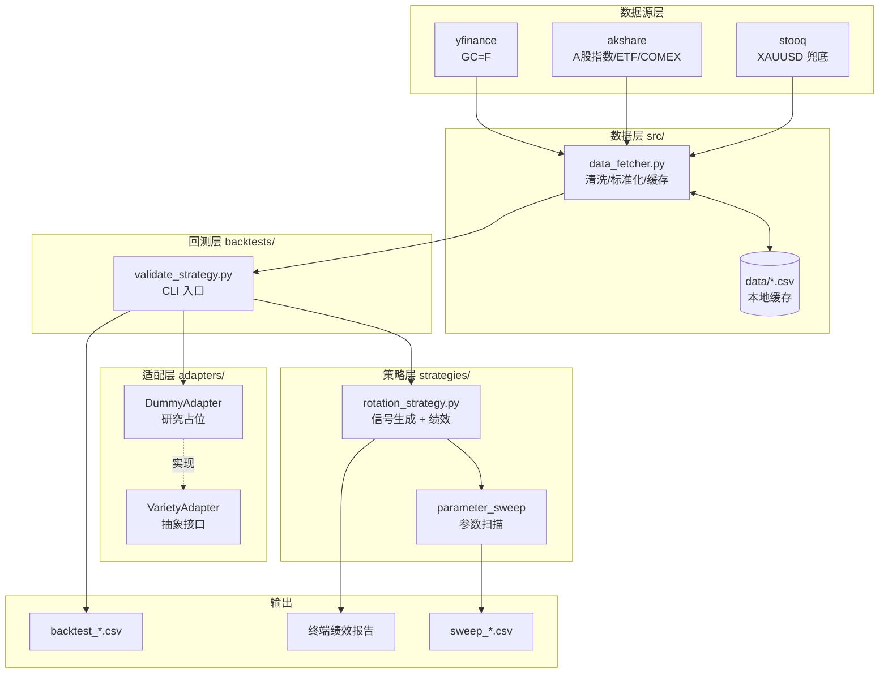

# 大类资产轮动研究框架（黄金期货 vs A股指数/ETF）

> 一个用于研究黄金期货（GC=F）与 A 股指数/ETF 之间动量轮动规律的量化研究框架。当前聚焦策略验证与回测，不涉及实盘交易。

## 目录

- [项目简介](#项目简介-project-overview)
- [架构图](#架构图-architecture)
- [技术栈](#技术栈-tech-stack)
- [功能介绍](#功能介绍-features)
- [功能截图/项目截图](#功能截图项目截图-screenshots)
- [部署方法](#部署方法-deployment)
- [策略逻辑](#策略逻辑-strategy-logic)
- [数据说明](#数据说明-data-sources)
- [项目结构](#项目结构-file-structure)
- [免责声明](#免责声明-disclaimer)

## 项目简介 (Project Overview)

本项目用于研究与验证黄金期货（GC=F）与 A 股指数/ETF 之间的轮动规律，当前聚焦策略验证，不涉及实盘交易。框架包含数据获取、动量轮动策略、回测验证及未来实盘适配接口占位。

核心能力：

- 多源数据获取（akshare / yfinance / stooq 多级回退）
- 黄金 / A 股动量轮动信号生成（日 / 周 / 月调仓可选）
- 完整回测引擎（含手续费、换手率、未来函数防护）
- 绩效指标自动计算（CAGR、夏普、最大回撤、卡玛比率）
- 多周期参数扫描对比
- 实盘适配器接口占位（`VarietyAdapter`）

## 架构图 (Architecture)



数据流说明：`validate_strategy.py` 通过 `data_fetcher` 拉取黄金与 A 股数据 → 调用 `rotation_strategy.generate_signals` 生成信号与组合收益 → 通过 `performance_summary` 计算指标 → 同时调用 `DummyAdapter` 验证适配器接口连通性。

## 技术栈 (Tech Stack)

| 类别 | 组件 | 说明 |
| --- | --- | --- |
| 语言 | Python 3.10+ | 使用 dataclass、类型注解、Literal |
| 数据获取 | akshare 1.18 | A 股指数/ETF/COMEX 期货 |
| 数据获取 | yfinance 1.1 | Yahoo Finance（GC=F）|
| 数据兜底 | stooq | XAUUSD 现货（akshare 与 yfinance 均失败时）|
| 数据处理 | pandas 2.3 | 时间序列对齐、ffill、resample |
| 数值计算 | numpy 2.2 | 收益/波动率/夏普比率 |
| 测试 | pytest 7+ | 单元测试 + 未来函数泄漏验证 |
| 接口设计 | abc / dataclass | 抽象适配器 + 配置类 |

## 功能介绍 (Features)

### 1. 多源数据获取与缓存

- 黄金期货优先级：`akshare COMEX` → `stooq XAUUSD` → `yfinance GC=F`，自动多级回退。
- A 股数据：通过 `fund_etf_hist_em`（ETF）或 `index_zh_a_hist`（指数）按代码前缀自动识别。
- 列名中英文映射、时区统一归一到 `Asia/Shanghai` 并 strip tz，避免中美市场时区漂移 1 天。
- 黄金数据缓存至 `data/gold_gc_f.csv`，离线可复用。

### 2. 动量轮动信号

- 固定窗口动量（默认 60 日）择时。
- 在 `GOLD` / `EQUITY` / `CASH` 三态间切换。
- 双资产均为负动量时持有现金位（`cash_annual_return` 可配置年化现金收益）。
- 调仓频率：`daily` / `weekly`（周五）/ `monthly` 可选。

### 3. 回测引擎

- **未来函数防护**：信号 T 日收盘生成，T+1 日生效（`position.shift(1)`），单元测试 `test_no_lookahead_bias` 强制校验。
- **手续费精细化**：
  - `CASH ↔ ASSET`：1× fee（单边）
  - `ASSET ↔ ASSET`：2× fee（先卖后买）
- **中美日历对齐**：`inner`（保守）或 `a_share_ffill`（默认，最多 ffill 5 天黄金缺失）两种模式。
- **预热期处理**：动量回看窗口填满前策略只能持有现金，绩效统计会剔除该预热期，使策略与基准在同一投资区间内比较。
- 同时输出策略净值曲线与基准（买入持有）净值曲线对比。

### 4. 绩效指标

- CAGR（年化收益率）
- 波动率（年化，√252）
- 夏普比率
- 最大回撤
- 卡玛比率（Calmar = CAGR / |MaxDD|）
- 日 / 年化换手率

### 5. 参数扫描与样本外验证

- 内置 `parameter_sweep()`，默认对比 `20 / 60 / 120` 日窗口。
- 一键输出多周期 CAGR / 夏普 / 回撤 / Calmar / 期末净值对比表，并附基准与超额指标。
- 内置 `walk_forward_validation()`：滚动窗口内选参、窗口外检验，拼接样本外净值，避免参数选择的前视偏差。

### 6. 实盘适配器接口

- `VarietyAdapter` 抽象基类（`fetch_quote` / `fetch_positions` / `place_order`）。
- 内置 `DummyAdapter` 用于研究阶段占位。
- 实盘接入时只需实现接口，策略层无需改动。

## 功能截图/项目截图 (Screenshots)

### 终端回测输出示例

```
Saved backtest results to /workspace/data/backtest_510300.csv

结论：策略累计净值 2.15 vs 基准 1.48（超额 +45.3%）

策略指标 vs 基准（买入持有）:
  指标            策略        基准
  ------------------------------
  年化收益率      8.12%      5.43%
  波动率          12.05%     18.42%
  夏普比率         0.6738     0.2948
  最大回撤        -14.32%    -32.18%
  卡玛比率         0.5671     0.1687

策略期末净值: 2.1500
基准期末净值: 1.4800
平均日换手率: 1.85%
平均年化换手率: 4.7x
Adapter (stub) quote example: {'symbol': '510300', 'status': 'stub', 'price': None}
```

### 参数扫描输出示例

```
多周期动量参数对比:
          cagr      vol   sharpe   max_dd   calmar  last_nav  bench_cagr  bench_sharpe  excess_cagr
lookback
20d      0.0138   0.1489   0.1635  -0.2513   0.0551    1.0584      0.1042        0.5907      -0.0903
60d      0.0694   0.1546   0.4964  -0.2722   0.2550    1.3192      0.1042        0.5907      -0.0348
120d     0.1253   0.1578   0.8018  -0.2000   0.6267    1.6282      0.1042        0.5907       0.0212

Saved sweep results to /workspace/data/sweep_510300.csv
```

> 参数扫描会剔除各窗口的动量预热期，并统一到同一评估起点再对比；同时给出 `bench_*` 与 `excess_cagr`，避免把市场 beta 误判为策略 alpha。

### 回测 CSV 输出字段

| 列名 | 含义 |
| --- | --- |
| `signal` | T 日收盘生成的目标仓位（GOLD/EQUITY/CASH）|
| `position` | T+1 实际执行仓位（防未来函数）|
| `gold_ret` | 黄金日收益率 |
| `equity_ret` | A 股日收益率 |
| `portfolio_ret` | 策略组合日收益率（扣费后）|
| `mom_gold` | 黄金动量（日频对齐，预热期为 NaN）|
| `mom_equity` | A 股动量（日频对齐，预热期为 NaN）|
| `strategy_curve` | 策略累计净值 |
| `benchmark_curve` | 基准累计净值 |

## 部署方法 (Deployment)

### 方式一：本地部署（推荐用于研究）

1. **克隆仓库**
   ```bash
   git clone <repo-url>
   cd <repo-dir>
   ```

2. **创建并激活虚拟环境**
   ```powershell
   python -m venv .venv
   # Windows PowerShell
   .\.venv\Scripts\activate
   # Linux / macOS
   source .venv/bin/activate
   ```

3. **安装依赖**
   ```powershell
   # 生产锁定版本
   pip install -r requirements.txt
   # 或开发版（宽松版本 + pytest）
   pip install -r requirements-dev.txt
   ```

4. **运行回测**
   ```powershell
   python backtests/validate_strategy.py
   ```
   运行后会在 `data/` 目录生成回测 CSV，并在终端打印绩效指标。

5. **（可选）运行单元测试**
   ```powershell
   pytest tests/ -v
   ```

### 方式二：Docker 部署

```dockerfile
FROM python:3.11-slim
WORKDIR /app
COPY requirements.txt .
RUN pip install --no-cache-dir -r requirements.txt
COPY . .
CMD ["python", "backtests/validate_strategy.py"]
```

构建与运行：

```bash
docker build -t gold-a-share-rotation .
docker run --rm -v $(pwd)/data:/app/data gold-a-share-rotation
```

### 常用 CLI 参数

```bash
python backtests/validate_strategy.py \
  --equity 510300 \
  --start 2015-01-01 \
  --lookback 60 \
  --rebalance weekly \
  --fee 5.0

# 多周期参数扫描
python backtests/validate_strategy.py --sweep

# 样本外滚动验证（walk-forward）
python backtests/validate_strategy.py --walk-forward --train-days 504 --test-days 126
```

| 参数 | 默认值 | 说明 |
| --- | --- | --- |
| `--equity` | `510300` | A 股 ETF/指数代码 |
| `--start` | `2015-01-01` | 起始日期 |
| `--lookback` | `60` | 动量回看天数 |
| `--rebalance` | `weekly` | 调仓频率（daily/weekly/monthly）|
| `--fee` | `5.0` | 单边手续费（bps）|
| `--sweep` | `false` | 启用多周期参数对比 |
| `--walk-forward` | `false` | 启用样本外滚动验证 |
| `--train-days` | `504` | walk-forward 训练窗口（交易日）|
| `--test-days` | `126` | walk-forward 测试窗口（交易日）|

### 网络注意事项

- 中国大陆直连 Yahoo Finance 可能不稳定，框架已默认优先使用 akshare 数据源，必要时可配置代理。
- 中美市场时区与节假日不同，框架通过 `a_share_ffill` 模式自动处理（最多 ffill 5 天黄金缺失，覆盖美国假期）。

## 策略逻辑 (Strategy Logic)

- 核心：使用固定窗口（默认 60 日）动量择时，在黄金与 A 股资产间轮动；若两者动量均为负，持有现金位。
- 调仓频率：日 / 周 / 月底可选（默认周五），换仓扣除单边费率（默认 5 bps）。
- 未来函数处理：信号在收盘后生成，**在回测执行时需滞后一日生效**，避免使用当日价格做当日决策的"未来函数"问题；请在实际策略运行时确保使用前一交易日的信号执行当日交易。

## 数据说明 (Data Sources)

- 黄金期货：Yahoo Finance (GC=F)。
- A 股指数/ETF：Akshare（`index_zh_a_hist`、`fund_etf_hist_em`）。
- 网络注意事项：
  - 中国大陆直连 Yahoo 可能不稳定，必要时配置代理或改用本地数据源。
  - 中美市场时区与节假日不同，请在研究时留意数据对齐与补全方式。

## 项目结构 (File Structure)

- `src/data_fetcher.py`：黄金与 A 股数据抓取与标准化、CSV 保存。
- `strategies/rotation_strategy.py`：动量轮动信号与绩效指标计算。
- `backtests/validate_strategy.py`：示例回测入口，下载数据并输出曲线与指标。
- `adapters/variety_adapter.py`：实盘 / 模拟交易适配器接口占位与 Dummy 实现。
- `tests/test_rotation_strategy.py`：单元测试（含未来函数验证、手续费验证）。
- `requirements.txt`：依赖清单（锁定版本）。
- `requirements-dev.txt`：开发版依赖（宽松版本 + pytest）。

## 免责声明 (Disclaimer)

本项目仅用于研究与教学，不构成任何投资建议。历史回测不代表未来表现，金融市场具有高度不确定性，使用者需自行承担全部风险。实盘交易前请充分评估策略有效性、流动性、滑点、成本及合规要求。
